<div align="center">

# Nexa Gadgets — Frontend

**An e-commerce store for genuine phones, laptops and audio in Lagos: a customer storefront and an admin dashboard in one React app.**

[**Live demo**](https://nexagadgets.vercel.app) · [**Backend repo**](https://github.com/Toyocodes/nexa-gadgets-backend) · [Report an issue](https://github.com/Toyocodes/nexa-gadget-frontend/issues)


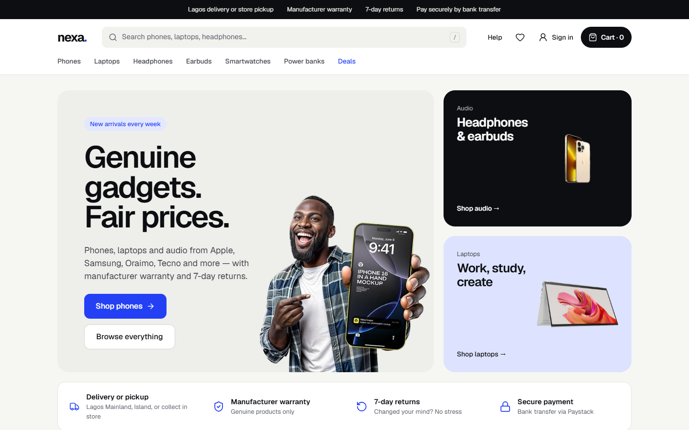

</div>

---

## Contents

- [Overview](#overview)
- [Features](#features)
- [Screenshots](#screenshots)
- [Tech stack](#tech-stack)
- [Architecture](#architecture)
- [Project structure](#project-structure)
- [Getting started](#getting-started)
- [Testing & quality](#testing--quality)
- [Deployment](#deployment)
- [Engineering decisions](#engineering-decisions)
- [Known limitations & roadmap](#known-limitations--roadmap)
- [License](#license)

---

## Overview

Nexa Gadgets sells genuine gadgets with manufacturer warranty and 7-day returns. Customers choose **store pickup or a paid Lagos delivery zone** and pay **by bank transfer through Paystack**. Delivery fees are set by the admin, so the frontend never hard-codes them.

This repository is the **React single-page app**. It talks to a separate **Express + MongoDB REST API** ([nexa-gadgets-backend](https://github.com/Toyocodes/nexa-gadgets-backend)), which handles auth, products, orders, Cloudinary uploads and payment verification.

Version 2 is a complete rewrite: React 19 + TypeScript, a light "studio" design system, mobile-first layouts, and every screen built from a design spec.

| Role         | Can do                                                                                          |
| ------------ | ----------------------------------------------------------------------------------------------- |
| **Guest**    | Browse, filter, search and read reviews. Tapping "+" or ♥ asks them to sign in, then finishes the action. |
| **Customer** | Cart, wishlist, saved addresses, checkout, order tracking, reviews of paid purchases, account settings |
| **Admin**    | Sales dashboard, product catalogue with photo gallery & specs, order fulfilment, delivery & pickup fees |

## Features

### Storefront

- **Category-led navigation:** Phones, Laptops, Headphones, Earbuds, Smartwatches, Power banks and Deals, plus one search bar (press <kbd>/</kbd> to focus it).
- **Listing:** filters for category, brand, price (presets and min/max), in stock and on sale. Sort by newest, price or rating. Removable filter chips and "Load more" pagination ("Showing 12 of 14"). **All filter state lives in the URL**, so views are shareable and the back button works.
- **Honest product cards:** stars only when a product has reviews (never "★ 0.0"), "Only N left" in amber, a sale badge only for real discounts, and a round "+" to add to cart.
- **Product page:** photo gallery (a swipe carousel on phones), spec chips and a spec table, one stock line, live delivery fees, reviews with a star breakdown, and "You might also like".
- **Cart drawer:** quantity steppers with optimistic updates, "You save ₦X", and "Delivery: chosen at checkout".
- **Focused checkout:** no store navigation, with step indicators. Pickup or delivery-zone cards come from the API, and the address section appears only for delivery. Saved addresses or a new one with a fixed `+234` phone prefix. "Pay ₦18,483 by transfer".
- **Orders:** separate trackers for delivery (Placed → Confirmed → In shipping → Delivered) and pickup (… → Ready for pickup → Collected). "Complete payment" on unpaid orders, and "Write a review" and "Buy again" on finished ones.
- **Accounts:** sign-up signs you straight in, with a password-strength meter. Errors appear under the field they belong to. "Email me a sign-in link", forgot and reset password, and Account details to change username, email (requires the current password) and marketing preferences.
- **Mobile first:** bottom tab bar, scrolling category chips, a buy bar fixed to the bottom, and a collapsible order summary at checkout.

### Admin

- **Dashboard:** revenue from **paid orders only**, plus paid orders, orders to fulfil and orders awaiting payment. Two single-series bar charts (7/14/30-day range) with a table view.
- **Products:** filterable table with stock pills. A slide-over form with a **drag-and-drop photo gallery** (reorder, cover photo, uploads in parallel to Cloudinary) and a **specs editor**.
- **Orders:** views for *To fulfil*, *Completed*, *Awaiting payment* and *Cancelled*. Status options depend on pickup vs delivery.
- **Delivery & pickup:** edit fees, names and descriptions (including the pickup address), switch options on or off, and add zones. Changes reach checkout immediately.

## Screenshots

<table>
  <tr>
    <td width="50%">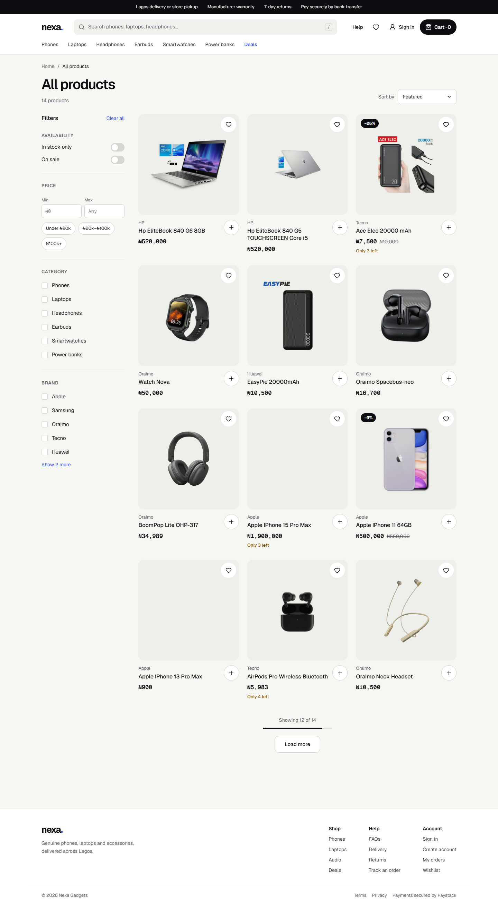<p align="center"><sub>Listing — URL-driven filters, chips, Load more</sub></p></td>
    <td width="50%">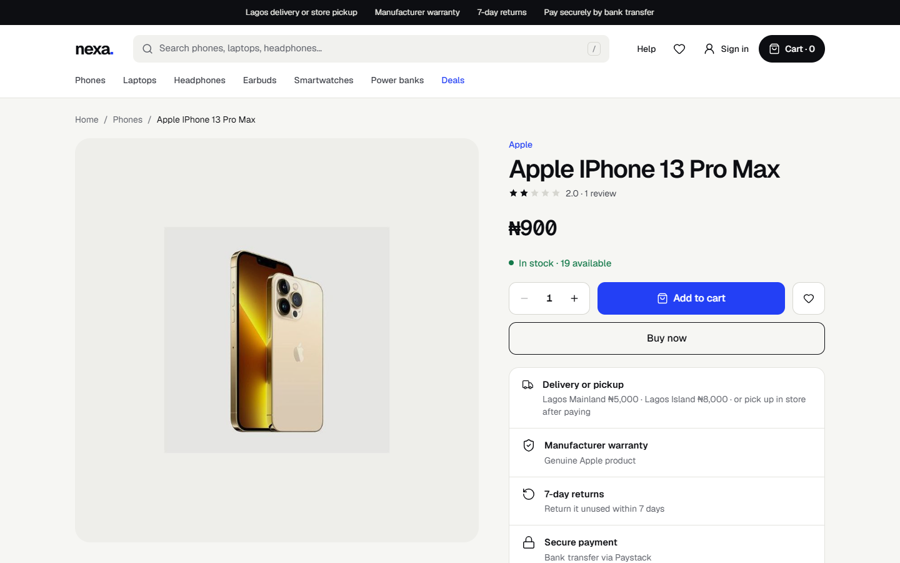<p align="center"><sub>Product page with live delivery fees and reviews</sub></p></td>
  </tr>
  <tr>
    <td width="50%">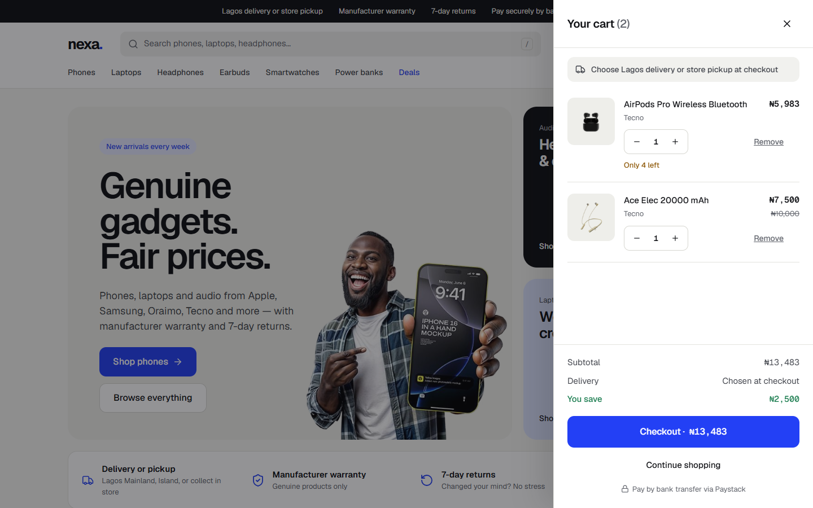<p align="center"><sub>Cart drawer</sub></p></td>
    <td width="50%">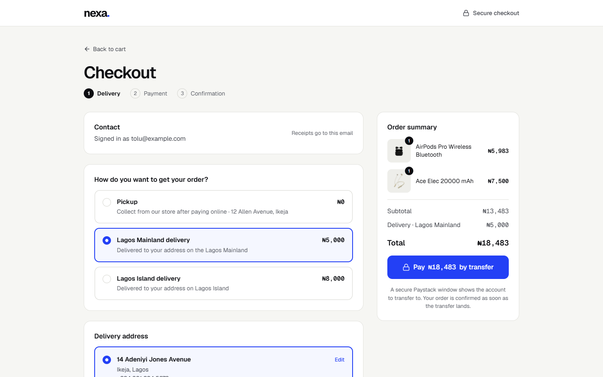<p align="center"><sub>Checkout — fees from the API, bank transfer only</sub></p></td>
  </tr>
  <tr>
    <td width="50%">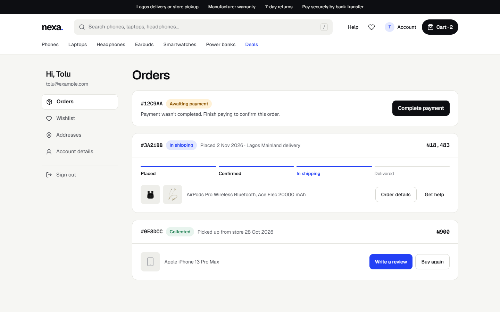<p align="center"><sub>Orders with delivery/pickup trackers</sub></p></td>
    <td width="50%">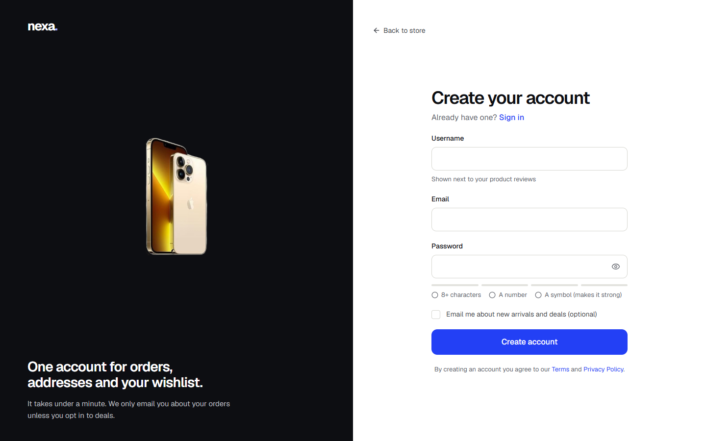<p align="center"><sub>Create account with password-strength meter</sub></p></td>
  </tr>
  <tr>
    <td width="50%">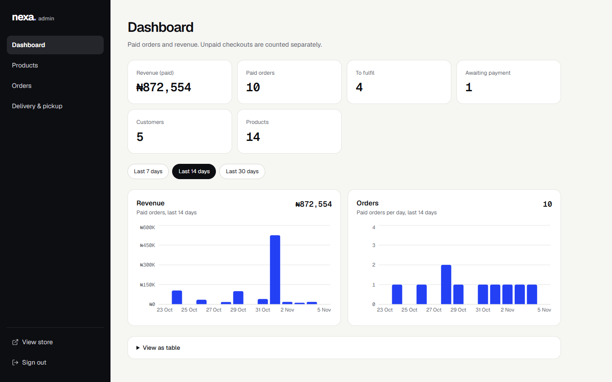<p align="center"><sub>Admin dashboard — paid revenue, single-axis charts</sub></p></td>
    <td width="50%">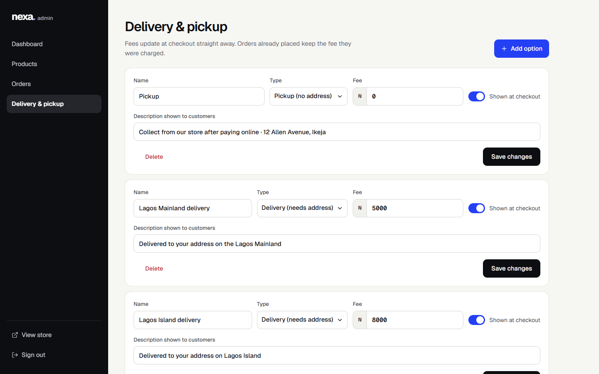<p align="center"><sub>Admin › Delivery & pickup fees</sub></p></td>
  </tr>
</table>

<p align="center">
  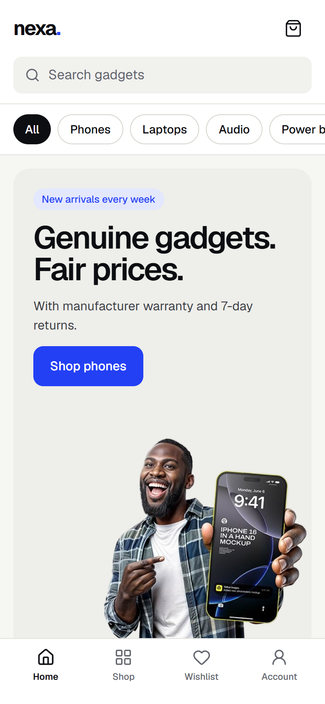&nbsp;
  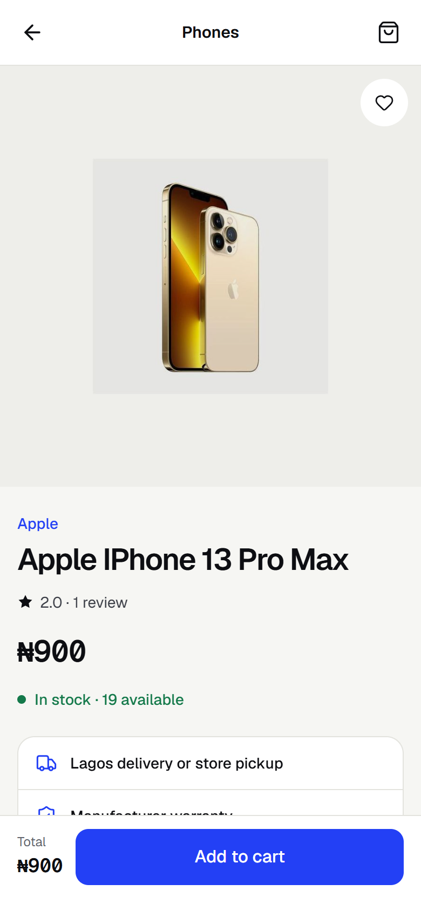&nbsp;
  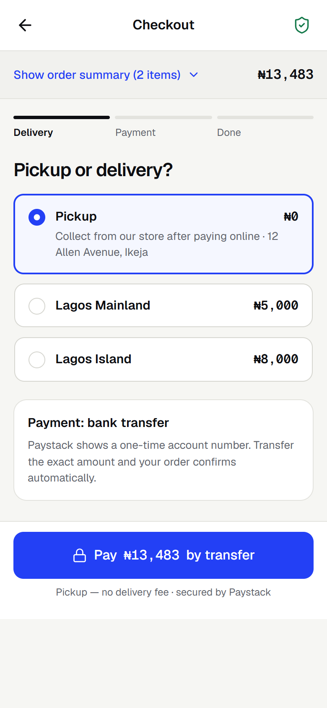
</p>

## Tech stack

| Concern       | Choice                                                                  | Why                                                                                              |
| ------------- | ----------------------------------------------------------------------- | ------------------------------------------------------------------------------------------------ |
| UI            | **React 19** + **React Compiler**                                       | Automatic memoisation, no hand-written `useMemo`/`useCallback` for performance; `<title>` in components |
| Language      | **TypeScript** (strict, `noUncheckedIndexedAccess`)                     | API shapes in [`src/types/api.ts`](src/types/api.ts) are checked end to end                       |
| Build         | **Vite 8** (Rolldown)                                                    | Fast dev server; route-level code splitting                                                      |
| Server state  | **RTK Query** (Redux Toolkit 2)                                          | Caching, tag invalidation, optimistic updates, infinite queries for "Load more"                    |
| Client state  | Two tiny Redux slices                                                   | Only what the server doesn't know: who's signed in, and whether the cart drawer is open          |
| Routing       | **React Router 7** data router                                           | Lazy routes, layout routes for guards, route `handle`s for per-page layout                        |
| Styling       | **Tailwind CSS 4** + **shadcn/ui** (Radix)                               | Design tokens as CSS variables; accessible primitives restyled to the design                     |
| Forms         | **react-hook-form** + **zod**                                            | Schema validation, inline field errors, `useWatch` for live password strength                    |
| Charts        | Recharts                                                                | Loaded only in the admin dashboard chunk                                                          |
| Payments      | Paystack Inline, `channels: ["bank_transfer"]`                           | Script loaded on demand; the server verifies every payment                                       |
| Tests         | **Vitest** + Testing Library                                            | Business rules (pricing, trackers, filters, validation) are unit-tested                           |
| Fonts         | Geist + Geist Mono (self-hosted via Fontsource)                         | Prices in mono for alignment; no third-party font requests                                        |

## Architecture

### Feature folders

Code is grouped by **what it does**, not by file type. Each feature owns its API endpoints, hooks, components and pages:

```
features/auth      → session slice, auth endpoints, route guards, sign-in/up, magic link, reset
features/catalog   → products, search, reviews · home, listing, product pages
features/cart      → cart endpoints (optimistic), drawer, useCart / useAddToCart
features/wishlist  → wishlist endpoints, useWishlist
features/checkout  → delivery options, addresses, orders, Paystack return
features/account   → orders, order details, wishlist, addresses, account details
features/admin     → dashboard, products (gallery + specs), orders, delivery & pickup
features/content   → FAQ, delivery, returns, legal, 404
```

### Data flow

One RTK Query API ([`src/lib/api/base-api.ts`](src/lib/api/base-api.ts)) holds all server state, and each feature injects its endpoints. Components call generated hooks (`useGetCartQuery`, `useCreateOrderMutation`…). No component calls `fetch` directly.

- **Errors:** every API error keeps the server's `{ message }`, which is written for end users. [`getErrorMessage`](src/lib/api/errors.ts) shows it, so there are no blank toasts.
- **Expired sessions:** a `401` from a protected endpoint clears the user, and the route guard sends them to sign in with a `?redirect=` back to where they were.
- **Rate limits:** a `429` on auth forms disables submit with a countdown.
- **Cache invalidation:** tags tie things together. Posting a review refetches that product's rating, and paying for an order refreshes orders, cart and stock.

### Auth & route protection

The session is an **httpOnly cookie**; the app never reads or stores a token. One `check-auth` call runs on load, and only guarded routes wait for it, so public pages render immediately. Three layout routes do the guarding: `RequireAuth`, `RequireAdmin` and `GuestOnly`.

Guests who tap "+" or ♥ have that intent saved, are sent to sign in, and the action completes when they return ([`pending-intent.ts`](src/lib/pending-intent.ts)).

### Checkout & payment

```
choose pickup / zone  →  (delivery) save or pick an address
→ POST /shop/order/create { deliveryOptionId, addressInfo.addressId }
→ server returns totalAmount   ← the browser never decides the price
→ Paystack popup, bank transfer only, amount = totalAmount × 100 (kobo)
→ /checkout/payment?reference=…  →  PUT /shop/order/verify  →  confirmation
```

If the customer closes Paystack and tries again, the same order is reused instead of creating duplicates. Unpaid orders can be paid later from **Orders › Complete payment**.

<details>
<summary><b>API endpoints used</b></summary>

| Area | Endpoints |
|---|---|
| Auth | `POST /auth/register` `/login` `/logout` `/forgot-password` `/magic-link` `/magic-link/verify` · `PUT /auth/reset-password/:token` `/auth/me` `/auth/change-password` · `GET /auth/check-auth` `/auth/me` |
| Catalog | `GET /shop/products/get` (filters, sort, `page`/`limit`) · `GET /shop/products/get/:id` · `GET /shop/search/:keyword` |
| Reviews | `GET /shop/review/:productId` · `POST /shop/review/add` |
| Cart | `GET /shop/cart/get/:userId` · `POST /shop/cart/add` · `PUT /shop/cart/update-cart` · `DELETE /shop/cart/:userId/:productId` |
| Wishlist | `GET /shop/wishlist/get/:userId` · `POST /shop/wishlist/add` · `DELETE /shop/wishlist/delete/:userId/:productId` |
| Addresses | `GET /shop/address/get/:userId` · `POST /shop/address/add` · `PUT /shop/address/update/:userId/:addressId` · `DELETE /shop/address/delete/:userId/:addressId` |
| Delivery | `GET /shop/delivery-options` |
| Orders | `POST /shop/order/create` · `PUT /shop/order/verify` · `GET /shop/order/list/:userId` · `GET /shop/order/details/:id` |
| Admin | `GET /admin/analytics/get` · products `get` / `add` / `edit/:id` / `delete/:id` / `upload-image` · orders `get` / `details/:id` / `update/:id` · `GET/POST/PUT/DELETE /admin/delivery-options` |

</details>

## Project structure

```
src/
├── app/            # store, router (lazy routes), root layout, paths
├── components/
│   ├── ui/         # shadcn/ui primitives, restyled to the design tokens
│   ├── layout/     # header, footer, mobile tab bar, store layout
│   ├── product/    # product image tile, price, rating, quantity stepper
│   ├── form/       # Field (label · input · inline error), prefix inputs
│   └── feedback/   # empty states, spinners, route error boundary
├── config/         # categories & brands (DB ids → labels), sort options, site facts
├── features/       # see "Feature folders" above
├── lib/            # API base + errors, formatting, Paystack loader, pending intent
├── styles/         # globals.css — design tokens (Tailwind v4 @theme)
└── types/          # API response types
```

## Getting started

**Prerequisites:** Node.js **20.19+** (developed on 22), the [backend API](https://github.com/Toyocodes/nexa-gadgets-backend) running locally or deployed, and a Paystack **test** public key.

```bash
git clone https://github.com/Toyocodes/nexa-gadget-frontend.git
cd nexa-gadget-frontend
npm install
cp .env.example .env    # then fill in the values
npm run dev             # http://localhost:5173
```

| Variable                   | Description                                                        |
| -------------------------- | ------------------------------------------------------------------ |
| `VITE_API_URL`             | Backend base URL including `/api`, e.g. `http://localhost:5000/api` |
| `VITE_PAYSTACK_PUBLIC_KEY` | Paystack **public** key (`pk_test_…`). Never the secret key.       |
| `VITE_SUPPORT_EMAIL`       | Optional. Shown on help pages; WhatsApp is used otherwise.         |

> The API must allow this app's origin in its CORS config with `credentials: true`, or the session cookie won't be sent.

### Trying a payment

The live demo uses Paystack **test mode**, so no real money moves. Create an account, add something to the cart and check out. Paystack's test transfer screen lets you simulate the transfer, and the order then confirms. Admin credentials are available on request.

> The API runs on Render's free tier, so the first request after a quiet spell can take 30–50 seconds while it wakes up.

| Command             | What it does                          |
| ------------------- | ------------------------------------- |
| `npm run dev`       | Vite dev server                       |
| `npm run build`     | Type-check, then production build      |
| `npm run preview`   | Serve the production build            |
| `npm run lint`      | ESLint (incl. React Compiler rules)   |
| `npm run typecheck` | `tsc -b`                              |
| `npm test`          | Vitest unit tests                     |
| `npm run format`    | Prettier (sorts Tailwind classes)     |

## Testing & quality

- **Unit tests** cover the rules most likely to break silently:
  - pricing (what's charged vs what counts as a discount)
  - order trackers for pickup vs delivery, including legacy statuses
  - listing filters → API query strings and page titles
  - spec chips, phone-number validation and normalisation
  - mapping API error messages to form fields
  - open-redirect protection
- **Strict TypeScript** with `noUncheckedIndexedAccess`; the build fails on type errors.
- **ESLint** with the React Compiler-aware hooks rules (e.g. no state-syncing effects; defaults are derived during render instead).
- **Accessibility:** real buttons and labels, `aria-invalid`/`aria-describedby` on fields, keyboard-operable dialogs, menus and gallery thumbnails, a skip link, and 44px touch targets.

## Deployment

Deployed on **Vercel**. [`vercel.json`](vercel.json) rewrites every path to `index.html` so deep links like `/products/:id` survive a refresh. Set the `VITE_*` variables in Vercel; they're inlined at build time, so changing one needs a redeploy. Old `/shop/*` URLs redirect to their new homes.

## Engineering decisions

- **Server state in RTK Query, not hand-written thunks.** The first version had 11 slices of `createAsyncThunk` + loading flags. RTK Query removes that boilerplate and adds caching, deduplication and optimistic updates. Redux stays for the two bits of genuinely client-side state.
- **Never trust the browser with money.** The order total comes from `POST /order/create`, and Paystack is charged that amount. The popup only offers bank transfer, because the server rejects every other channel.
- **Fees come from the API.** Checkout, the product page and the Delivery help page all read `/shop/delivery-options`, so an admin's fee change shows up everywhere without a deploy.
- **Show only what's true.** No "free delivery", no "★ 0.0", no discount badge when a sale price is *higher* than the price, and dashboard revenue counts paid orders only.
- **White product photos on a grey tile.** `mix-blend-mode: multiply` turns supplier photos' white backgrounds into the tile colour, so cards don't become bright boxes.
- **Defaults are derived, not synced.** Checkout's default delivery option and address are computed during render from server data plus the user's choice, not copied into state by effects.
- **Lazy everything admin.** Each route is its own chunk; Recharts only ships with the admin dashboard.

## Known limitations & roadmap

- [ ] **Field-level API errors:** the API returns one `message`, so forms map it to a field by wording. A `field` key in error responses would make this exact.
- [ ] **Per-order delivery notes and address labels** ("Home", "Office") need backend fields; today notes are saved on the address.
- [ ] **Guest cart:** guests are sent to sign in before adding to cart. A local cart merged on login needs a merge endpoint.
- [ ] **Search** uses a separate endpoint without filters or pagination; a `q` parameter on the products endpoint would unify it with the listing.
- [ ] **End-to-end tests** (Playwright) for checkout with a mocked Paystack.
- [ ] **Dark mode:** colours are already CSS variables; it needs a dark token set.
- [ ] **CI:** GitHub Actions running lint, typecheck, tests and build on every PR.

## License

Released under the [MIT License](LICENSE).

---

<div align="center">

Built by **Jadesimi Toyosi** · [GitHub](https://github.com/Toyocodes)

</div>
