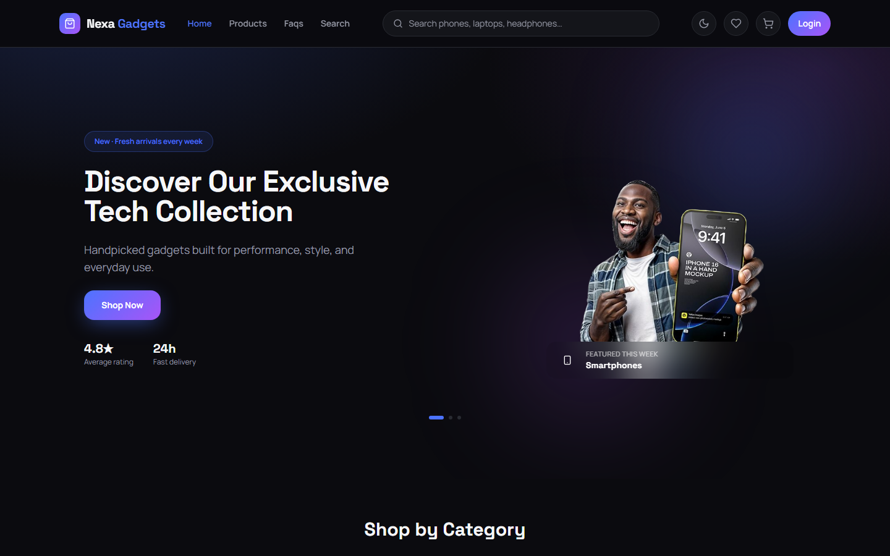
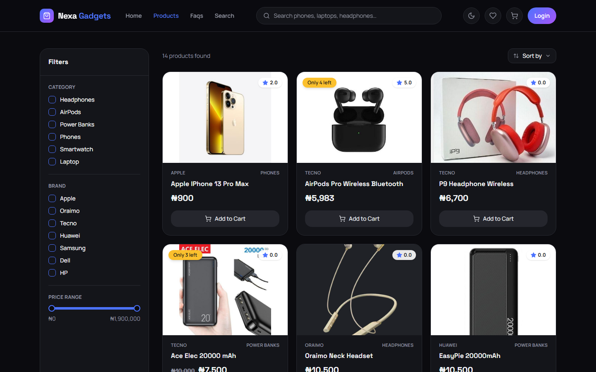
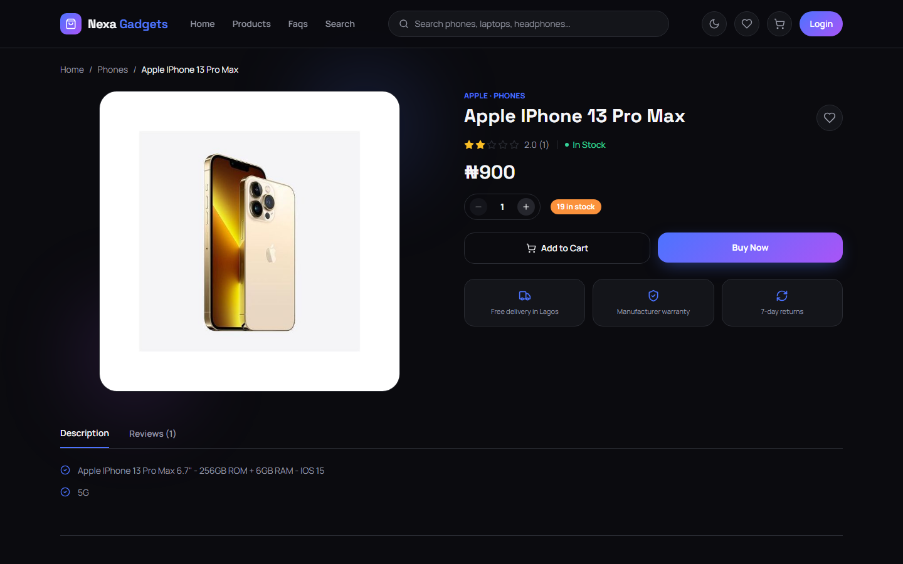
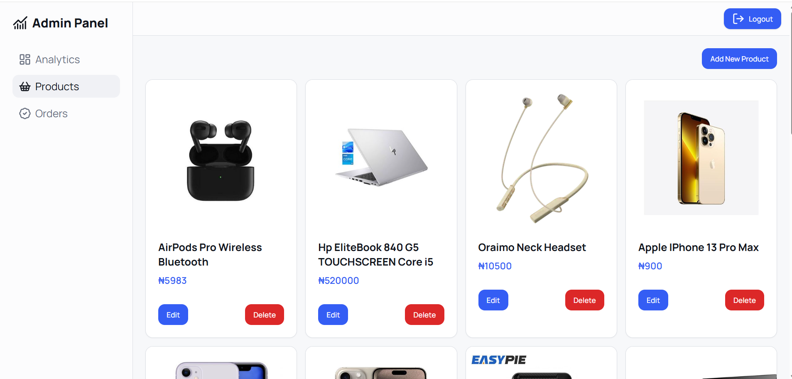
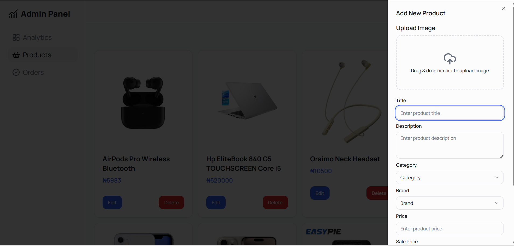
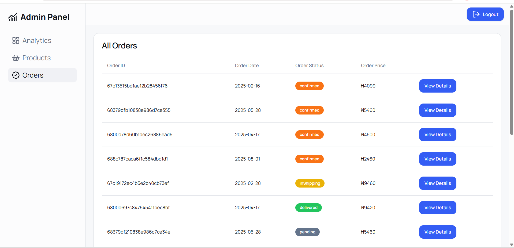
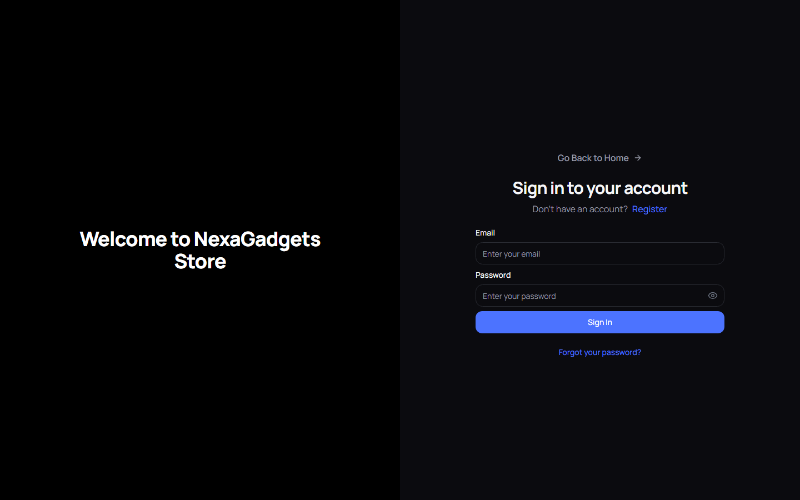
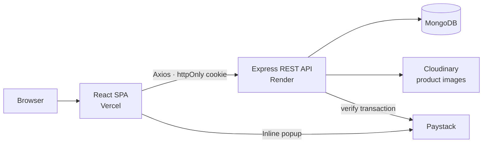
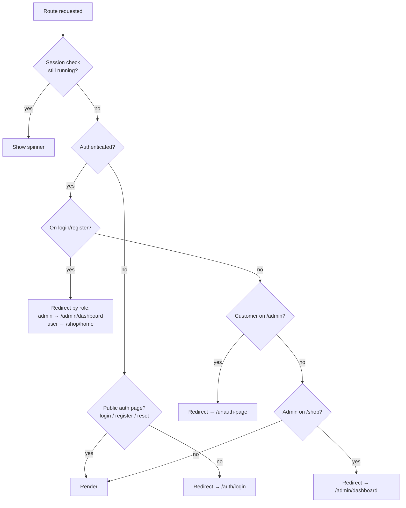
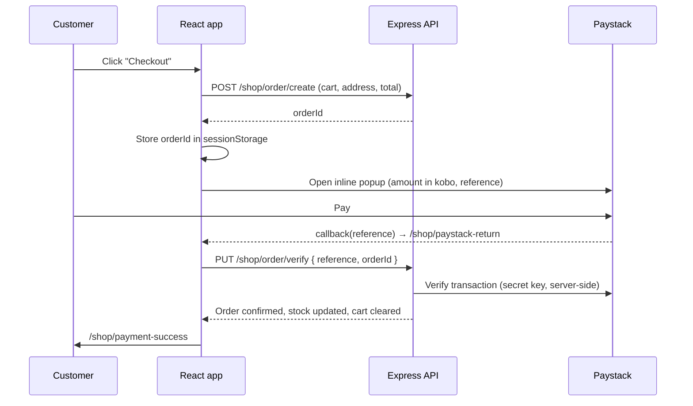

<div align="center">

# Nexa Gadgets — Frontend

**A full-stack e-commerce store for phones, laptops and accessories, with a customer storefront and an admin dashboard in one React app.**

[**Live demo**](https://nexagadgets.vercel.app) · [**Backend repo**](https://github.com/Toyocodes/nexa-gadgets-backend) · [Report an issue](https://github.com/Toyocodes/nexa-gadget-frontend/issues)




</div>

---

## Contents

- [Overview](#overview)
- [Features](#features)
- [Screenshots](#screenshots)
- [Tech stack](#tech-stack)
- [Architecture](#architecture)
- [Project structure](#project-structure)
- [Getting started](#getting-started)
- [Trying the payment flow](#trying-the-payment-flow)
- [Deployment](#deployment)
- [Engineering decisions](#engineering-decisions)
- [Known limitations & roadmap](#known-limitations--roadmap)
- [License](#license)

---

## Overview

Nexa Gadgets is an online gadget store built for the Nigerian market (prices in ₦, payments through Paystack). This repository is the **React single-page app**. It talks to a separate **Express + MongoDB REST API** ([nexa-gadgets-backend](https://github.com/Toyocodes/nexa-gadgets-backend)), which handles auth, products, orders, image uploads to Cloudinary, and payment verification.

The app has two experiences, chosen by the signed-in user's role:

| Role         | Lands on           | Can do                                                                  |
| ------------ | ------------------ | ----------------------------------------------------------------------- |
| **Guest**    | `/shop/home`       | Browse, filter, search, read product pages and reviews                  |
| **Customer** | `/shop/home`       | Everything above, plus cart, wishlist, addresses, checkout, order history and reviews |
| **Admin**    | `/admin/dashboard` | View sales analytics, manage the product catalogue, update order status |

## Features

### Storefront

- **Product catalogue** with filters by category, brand and price range, plus sorting by price or title
- **Product detail pages** with stock indicators, quantity selector, ratings and customer reviews
- **Search** across phones, laptops, headphones and more
- **Cart** that syncs with the server, so it persists across devices and sessions
- **Wishlist** for saving products for later
- **Address book** with up to three saved delivery addresses, one chosen at checkout
- **Checkout with Paystack** (inline popup), with server-side payment verification
- **Account area** with order history and order details
- **Auth flows:** register, login, logout, forgot password and reset password via an emailed token
- **Light and dark themes**, a responsive layout and Framer Motion transitions

### Admin dashboard

- **Analytics:** total users, products, sales and revenue, plus a sales/revenue trend chart (Recharts)
- **Product management:** create, edit and delete products, with drag-and-drop image upload to Cloudinary
- **Order management:** view all orders and update their status (`pending` → `confirmed` → `inProcess` → `inShipping` → `delivered`, or `rejected`)

## Screenshots

<table>
  <tr>
    <td width="50%"><p align="center"><sub>Listing with category, brand and price filters</sub></p></td>
    <td width="50%"><p align="center"><sub>Product detail page</sub></p></td>
  </tr>
  <tr>
    <td width="50%"><p align="center"><sub>Admin analytics</sub></p></td>
    <td width="50%"><p align="center"><sub>Admin product management</sub></p></td>
  </tr>
  <tr>
    <td width="50%"><p align="center"><sub>Add product drawer with Cloudinary upload</sub></p></td>
    <td width="50%"><p align="center"><sub>Order management with status tracking</sub></p></td>
  </tr>
  <tr>
    <td width="50%"><p align="center"><sub>Authentication</sub></p></td>
    <td width="50%"></td>
  </tr>
</table>

## Tech stack

| Concern         | Choice                                                                              | Why                                                                                                   |
| --------------- | ----------------------------------------------------------------------------------- | ----------------------------------------------------------------------------------------------------- |
| Build tooling   | [Vite 5](https://vitejs.dev/)                                                       | Near-instant dev server and HMR, and simple production builds                                         |
| UI              | React 18                                                                            | Component model and ecosystem                                                                         |
| State           | [Redux Toolkit](https://redux-toolkit.js.org/) + React Redux                        | Cart, auth, wishlist and orders are shared across many pages; `createAsyncThunk` keeps API state (loading/error/data) consistent |
| Routing         | React Router v6                                                                     | Nested layouts (`/shop`, `/admin`, `/auth`) and a single route guard                                  |
| Styling         | Tailwind CSS + [shadcn/ui](https://ui.shadcn.com/) on [Radix UI](https://www.radix-ui.com/) | Accessible primitives (dialogs, selects, sheets, tabs) that I own and can restyle, not a closed component library |
| Animation       | Framer Motion                                                                       | Declarative page and element transitions                                                              |
| Charts          | Recharts                                                                            | Composable React charts for the admin analytics                                                       |
| HTTP            | Axios (single shared instance)                                                      | One place for the base URL and `withCredentials` cookie handling                                      |
| Payments        | Paystack Inline JS                                                                  | The standard payment gateway for NGN transactions                                                     |
| Hosting         | Vercel (frontend), Render (API)                                                     | Zero-config SPA hosting with preview deploys                                                          |

## Architecture

### System overview



### State management

The Redux store is split into **slices by domain**, and each owns its own async thunks:

```
auth            → session, user, role, login/register/password reset
admin/products  → catalogue CRUD + image upload
admin/order     → all orders, status updates
shop/products   → listing (filters + sort as query params), product details
shop/cart       → server-backed cart
shop/wishlist   → server-backed wishlist
shop/address    → address book
shop/order      → order creation, Paystack verification, order history
shop/review     → product reviews
shop/search     → search results
common          → shared feature/banner content
```

Components dispatch thunks and read state with `useSelector`. No component calls Axios directly, so every network call lives in [`src/store`](src/store).

### Authentication and route protection

Auth uses an **httpOnly cookie** set by the API. The SPA never reads or stores the token itself. On boot, `App` dispatches a single `checkAuth()` call, and every protected route is wrapped in one guard component, [`CheckAuth`](src/components/common/check-auth.jsx):



Public storefront pages (home, listing, product, FAQ) are **not** wrapped in the guard. They render straight away, without waiting for the session check, so first paint isn't blocked by a network round-trip.

### Payment flow



The frontend only holds Paystack's **public** key. The order is marked paid only after the API verifies the transaction with Paystack using the secret key, so a tampered client callback can't confirm an order.

## Project structure

```
src/
├── components/
│   ├── admin-view/      # Admin layout, sidebar, analytics chart, image upload, order tables
│   ├── auth/            # Split-screen auth layout
│   ├── common/          # Route guard (CheckAuth), config-driven form, star rating, spinner
│   ├── shopping-view/   # Header, cart drawer, filters, product tiles, address book, orders
│   └── ui/              # shadcn/ui primitives (button, dialog, sheet, select, toast…)
├── config/              # Form schemas, nav menus, filter/sort options, category & brand maps
├── context/             # Theme provider (light/dark, persisted)
├── lib/                 # Shared Axios instance, `cn()` class helper
├── pages/
│   ├── admin-view/      # Dashboard, products, orders
│   ├── auth/            # Login, register, forgot/reset password
│   ├── shopping-view/   # Home, listing, product, search, checkout, account, wishlist, FAQ
│   ├── not-found/
│   └── unauth-page/
├── store/               # Redux Toolkit slices (see "State management")
├── App.jsx              # Route tree
└── main.jsx             # Providers: Redux, Router, Theme
```

Forms are **config-driven**. [`src/config`](src/config/index.js) describes the fields (type, label, options) and a single [`CommonForm`](src/components/common/form.jsx) renders them, so the login, register, address and product forms share one implementation.

## Getting started

### Prerequisites

- Node.js **18+** (developed on 22)
- A running instance of the [backend API](https://github.com/Toyocodes/nexa-gadgets-backend). Follow its README to start it locally, or point at a deployed instance.
- A [Paystack](https://paystack.com/) account for a **test** public key

### Setup

```bash
git clone https://github.com/Toyocodes/nexa-gadget-frontend.git
cd nexa-gadget-frontend
npm install
cp .env.example .env    # then fill in the values
npm run dev             # http://localhost:5173
```

### Environment variables

| Variable                   | Description                                   | Example                     |
| -------------------------- | --------------------------------------------- | --------------------------- |
| `VITE_API_URL`             | Base URL of the backend API, including `/api` | `http://localhost:5000/api` |
| `VITE_PAYSTACK_PUBLIC_KEY` | Paystack **public** key (never the secret key) | `pk_test_xxxxxxxx`          |

> The API must allow this app's origin in its CORS config, with `credentials: true`, or the auth cookie won't be sent.

### Scripts

| Command           | What it does                     |
| ----------------- | -------------------------------- |
| `npm run dev`     | Start the Vite dev server        |
| `npm run build`   | Production build to `dist/`      |
| `npm run preview` | Serve the production build locally |
| `npm run lint`    | Run ESLint                       |

## Trying the payment flow

The live demo runs Paystack in **test mode**, so no real money moves. Register a customer account, add items to the cart, and at checkout use Paystack's [test card](https://paystack.com/docs/payments/test-payments/):

| Field  | Value                 |
| ------ | --------------------- |
| Card   | `4084 0840 8408 4081` |
| Expiry | Any future date       |
| CVV    | `408`                 |
| PIN    | `0000`                |
| OTP    | `123456`              |

Admin credentials are available on request.

> The API is on Render's free tier, so the first request after a period of inactivity can take ~30–50 seconds while the server wakes up.

## Deployment

The frontend is deployed on **Vercel**. Because this is a client-side-routed SPA, [`vercel.json`](vercel.json) rewrites every path to `index.html`. Without that, refreshing a deep link like `/shop/product/:id` would return a 404:

```json
{ "rewrites": [{ "source": "/(.*)", "destination": "/index.html" }] }
```

Set `VITE_API_URL` and `VITE_PAYSTACK_PUBLIC_KEY` in the Vercel project settings. Vite inlines `VITE_*` variables at build time, so changing them requires a redeploy.

## Engineering decisions

- **httpOnly cookies, not localStorage tokens.** The session token can't be read by JavaScript, which removes the most common XSS token-theft path. The trade-off is that CORS and cookie `SameSite` settings have to be configured correctly between the Vercel and Render domains.
- **A non-blocking session check.** Auth state has two flags: `isLoading` for user actions like login, and `isCheckingAuth` for the one-time boot check. Only guarded routes wait on `isCheckingAuth`, so public pages render immediately instead of every visitor seeing a full-screen spinner.
- **One app with role-based layouts, not two apps.** The admin and storefront share the UI kit, auth, API client and store. A single route guard decides who sees what. Splitting them would make sense if the admin grew a separate team or release cycle.
- **All network calls in thunks.** Components stay presentational and every request goes through one Axios instance, so loading and error states are predictable and the API layer is easy to change.
- **Server-side cart and wishlist.** These persist across devices and survive logout/login. The cost is a network round-trip per cart change, which is acceptable at this scale.
- **Payment verification is the server's job.** The client only starts the payment. Order confirmation happens after the API verifies the reference with Paystack.

## Known limitations & roadmap

- [ ] **Tests:** add Vitest + React Testing Library for slices and the `CheckAuth` guard, and Playwright for checkout
- [ ] **TypeScript:** migrate to TypeScript, starting with the store and API layer
- [ ] **Data fetching:** move server state (products, orders) to RTK Query for caching and request deduplication
- [ ] **Performance:** lazy-load the admin bundle with `React.lazy` so customers don't download it
- [ ] **Payments:** generate the Paystack reference on the server instead of the client
- [ ] **Guest cart:** let guests build a cart before signing in, then merge it on login
- [ ] **CI:** GitHub Actions running lint and build on every pull request

## License

Released under the [MIT License](LICENSE).

---

<div align="center">

Built by **Jadesimi Toyosi** · [GitHub](https://github.com/Toyocodes)

</div>
